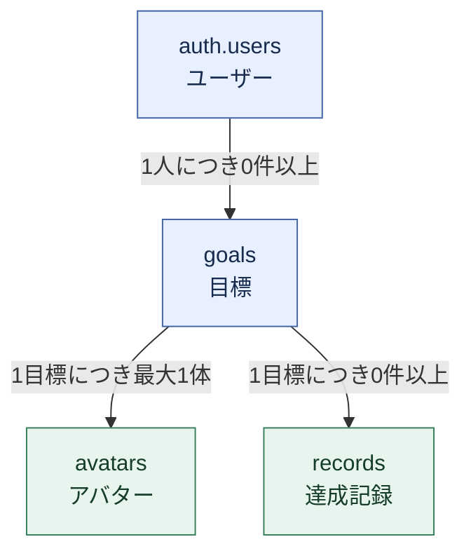
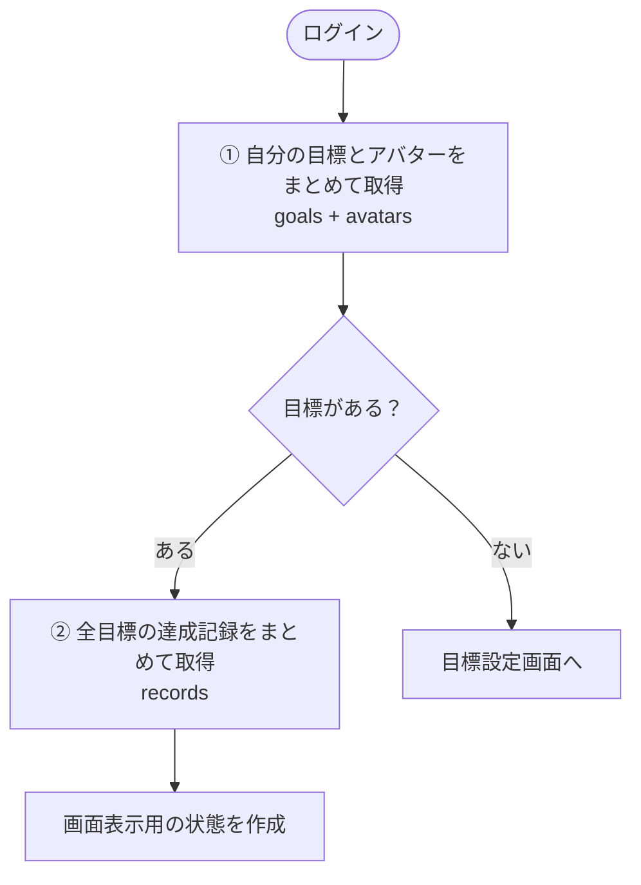
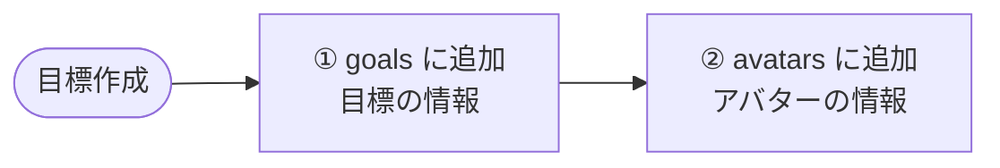
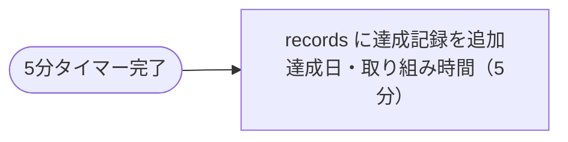
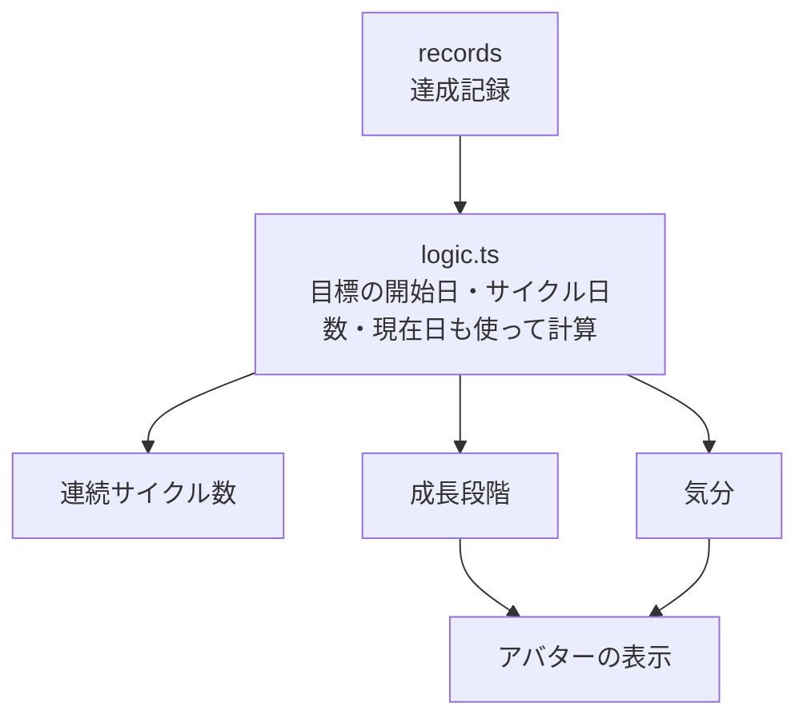
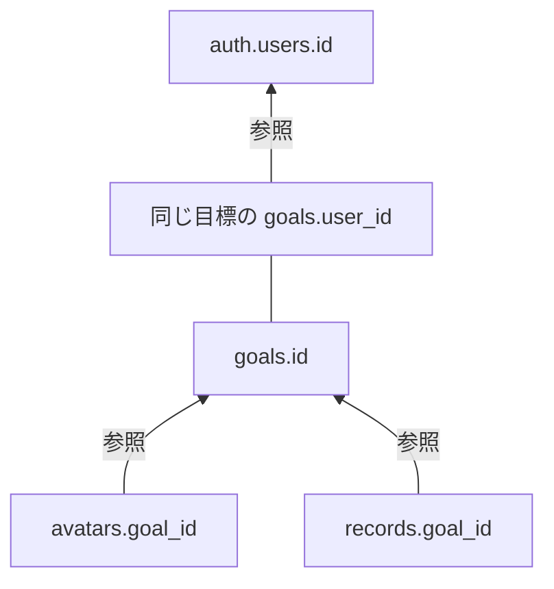
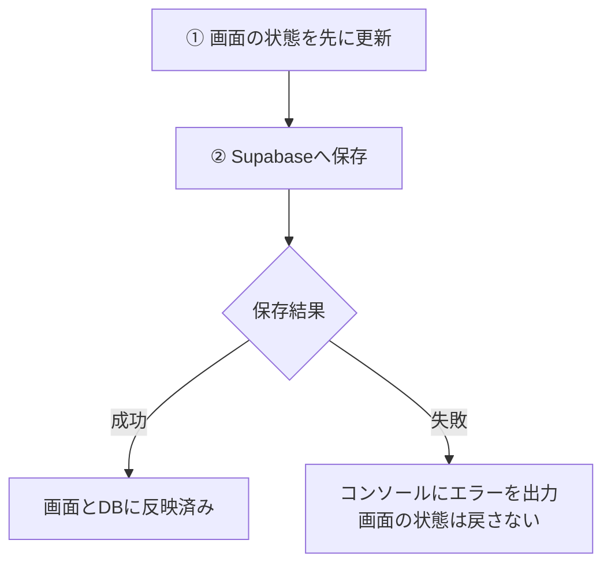
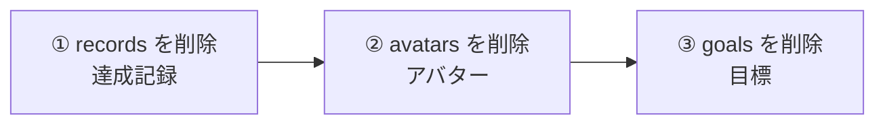
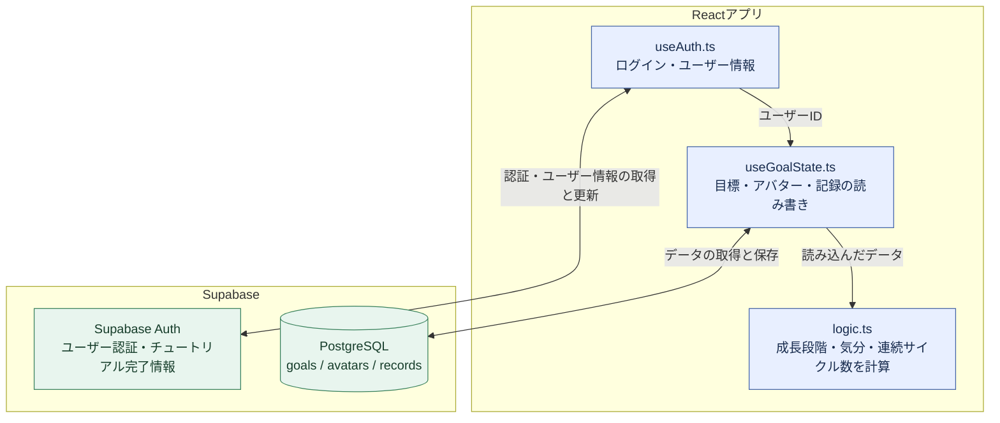
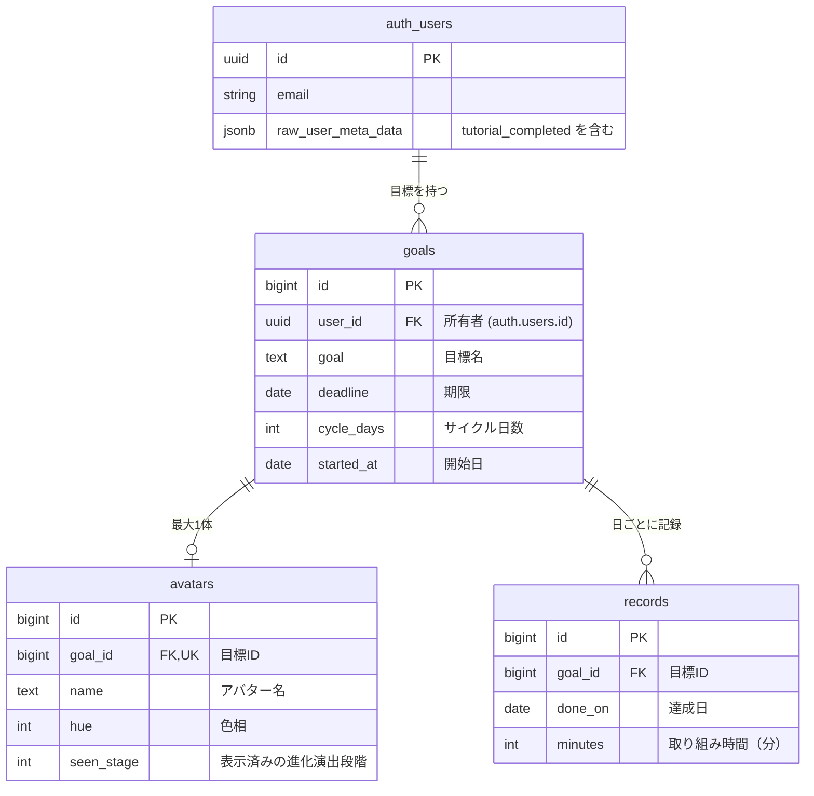

# Supabaseを使ったデータ管理

このアプリでは、**Supabaseのデータベースに「目標・アバター・達成記録」を保存し、ユーザー認証にはSupabase Authを使用しています。**

---

## 保存するデータ

| 保存先 | 主な内容 | 関係 |
| --- | --- | --- |
| `auth.users` | ユーザー情報、認証情報、チュートリアル完了情報 | 1人のユーザーが複数の目標を持つ |
| `goals` | 所有者、目標名、期限、サイクル日数、開始日 | 目標の中心となるテーブル |
| `avatars` | アバター名、色、進化演出をどこまで表示したか | 1つの目標につき最大1体 |
| `records` | 達成日、取り組み時間 | 1つの目標に複数の達成記録 |

### 関連ファイル

- `supabase/schema.sql`

---

## テーブル同士の関係



ユーザーを起点として、そのユーザーが複数の目標を持ちます。

さらに、それぞれの目標には、

- 最大1体のアバター
- 複数の達成記録

が紐づく構造になっています。

---

## データの読み込み

ログイン後は、以下の順番でデータを取得します。



これにより、ユーザーごとの目標・アバター・達成状況を復元できます。

---

## データの書き込み

### 目標を作成するとき

目標作成時には、主に2つのテーブルへデータを追加します。



`goals`には目標そのものの情報を保存し、`avatars`にはその目標に対応するアバター情報を保存します。

---

### 目標を達成したとき

目標を達成すると、`records`に達成記録を追加します。

保存する主な情報は、

- 達成日
- 取り組み時間

です。

現在の実装では、取り組み時間は**5分固定**になっています。



---

## 派生データ

アバターの状態などはDBに直接保存せず、`records`から計算しています。

例えば、



という流れです。

このように、DBには元となるデータだけを保存し、必要な情報はアプリ側で計算しています。

### 関連ファイル

- `logic.ts`

---

## 外部キー

テーブル同士は外部キーによって関連付けています。



矢印は参照先を示します。`avatars`と`records`がそれぞれ`goals`を参照し、`goals.user_id`がユーザーを参照します。

これにより、

- 存在しないユーザーの目標
- 存在しない目標のアバター
- 存在しない目標の達成記録

などが作られにくくなります。

---

## 一意制約

重複データを防ぐため、一意制約も使用しています。

### avatars

```text
1つの目標につきアバターは最大1体
```

### records

```text
同じ目標・同じ日には達成記録は1件まで
```

これによって、誤操作などによるデータの重複をDB側でも防げます。

---

## 楽観的更新

達成記録や進化演出の状態では、DB保存より先に画面を更新する処理があります。



この方法を**楽観的更新（Optimistic Update）**と呼びます。

操作した結果がすぐに画面へ反映されるため、ユーザー体験は良くなります。

一方で、現在は保存に失敗した場合、

```text
console.error()
```

などでエラーを出すだけになっています。

そのため、

- 画面の状態を元に戻す
- 再試行する
- ユーザーにエラーを表示する

といった処理は今後の改善ポイントです。

---

## 目標削除

削除操作は現在、主に開発用画面から行います。

削除時は、



の順に削除しています。

これはテーブル間に外部キーによる関連付けがあるためです。

---

# DBに関する主な概念

| 概念 | このアプリでの利用 |
| --- | --- |
| テーブル設計 | `goals`、`avatars`、`records` |
| リレーション | ユーザー → 目標 → アバター・記録 |
| 外部キー | テーブル同士の関連を保証 |
| 参照整合性 | 存在しないデータへの紐付けを防止 |
| 一意制約 | アバターや達成記録の重複を防止 |
| RLS | ユーザーごとのアクセス制御 |
| データ永続化 | Supabase DB / Supabase Auth |
| 派生データ | 達成記録から成長状態などを計算 |
| 楽観的更新 | DB保存前に画面を更新 |

---

## 全体像



この構成によって、**Supabaseにはアプリの基礎となるデータを保存し、アバターの成長状態などは保存済みの達成記録から計算する設計**になっています。

## テーブルの詳細（ER図）

主なカラムを示しています。`PK`は主キー、`FK`は外部キー、`UK`は一意制約です。
`records`は`goal_id`と`done_on`の組み合わせで一意になります。
チュートリアル完了情報は独立した列ではなく、Authの`user_metadata`内の`tutorial_completed`に保存します。


